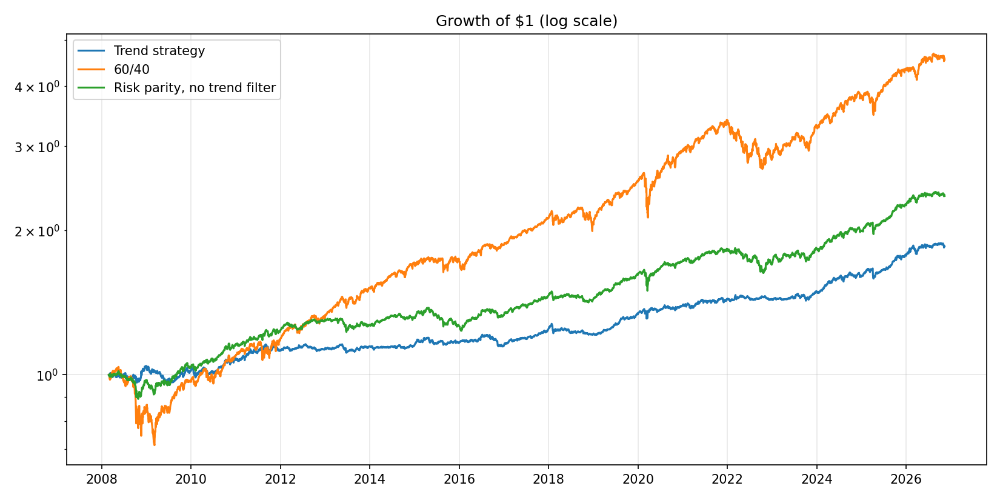
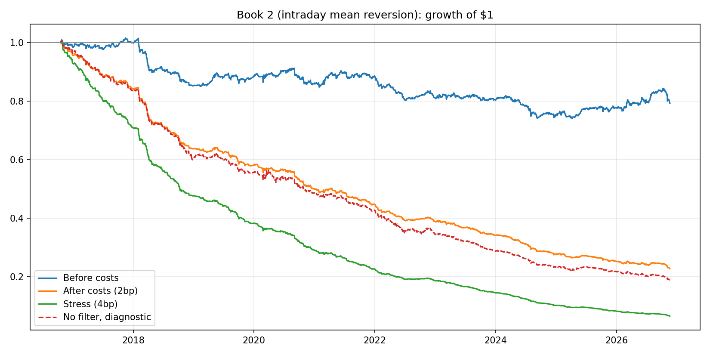
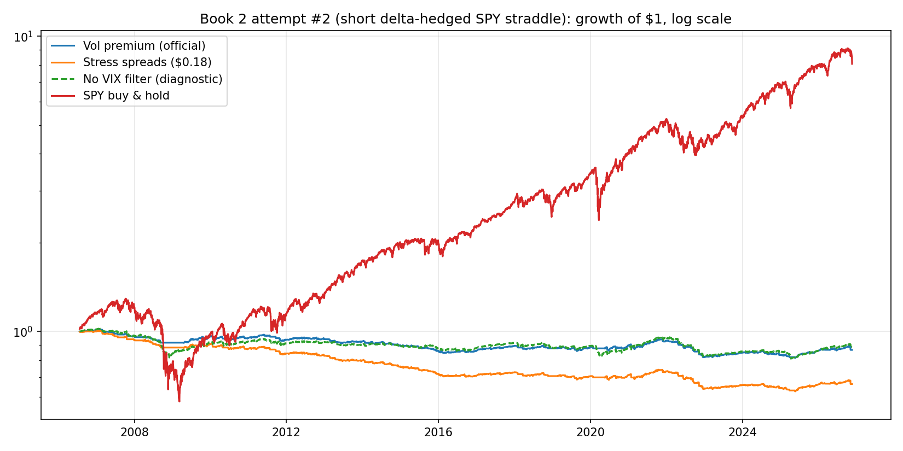

# Trading Algo: a two-book systematic trading project

I'm an Economics & CS student at Boston University, and I want to be a trader.
So instead of just reading about markets, I built a small trading desk in Python
and ran it like a real one: two "books", every rule written down before testing,
realistic costs, and honest results, including the stuff that didn't work.

Most backtests you see online look amazing. Mine mostly don't, and that's kind
of the point. Here's what's in here:

| Book | Strategy | Status |
|---|---|---|
| **Book 1 (core)** | Cross-asset trend following on 8 ETFs, risk-parity sizing | **Works.** Backtested 2008-2026, going live in paper trading |
| **Book 2 (tactical), attempt #1** | Intraday mean reversion on 10 ETFs, 15-min bars | **Failed.** No edge, even before costs |
| **Book 2 (tactical), attempt #2** | Volatility risk premium: short delta-hedged SPY straddles | **Failed.** Premium too thin at the money once you price it right |

---

## Book 1: Cross-asset trend following

### The idea

Markets trend. Big macro moves (a hiking cycle, a dollar rally, a commodity boom)
play out over months, not days, because investors under-react to news. So the
rule is simple: **hold an asset if it's up over the last 12 months, otherwise sit
in T-bills.**

The universe is 8 ETFs, one per macro asset class:

| Equities | Rates | Real assets | FX |
|---|---|---|---|
| SPY (US), EFA (developed ex-US), EEM (emerging) | TLT (20y+ Treasuries), IEF (7-10y) | GLD (gold), DBC (commodities) | UUP (US dollar) |

### The rules

- **Signal:** 12-month return > 0 → hold it. Otherwise its slice goes to **BIL** (T-bills).
- **Sizing:** each asset gets weight proportional to **1 / its 60-day volatility** (risk
  parity). Without this, stocks and commodities (1-2% daily swings) would drown out
  bonds (~0.4%). This way each asset brings roughly the same risk.
- **Trading:** rebalance weekly at Friday's close. **5bp cost** on every dollar traded.
- **Long-only, no leverage.**
- All parameters are standard values picked up front. Nothing was tuned to make the
  backtest look better.

### Results (Feb 2008 to Nov 2026)

| | Trend strategy | 60/40 | Same basket, no trend filter |
|---|---|---|---|
| Annual return | 3.4% | 8.5% | 4.7% |
| Volatility | 4.5% | 11.3% | 5.7% |
| Sharpe | 0.76 | 0.77 | 0.83 |
| **Max drawdown** | **-7.7%** | **-31.4%** | -12.5% |
| Costs / year | 0.31% | 0.03% | 0.08% |



**My honest takeaway:** the trend filter did what it's supposed to do on drawdowns.
-7.7% worst case vs. -31.4% for a 60/40 through 2008, 2020 and 2022, at about the
same Sharpe. But it **lowered** the Sharpe compared to just always holding the same
risk-parity basket (0.76 vs 0.83). So the filter bought protection, it didn't add
return. I'm reporting that as is.

### Going live

`src/rebalance.py` computes this week's target weights with the **exact same code as
the backtest**, turns them into whole-share orders, and trades an Alpaca **paper**
account:

- Dry run by default: it prints the orders and sends nothing.
- With `--send` it asks me to type "yes" before anything goes out.
- **Market-on-close orders**, so fills happen at the official closing price, which is
  exactly what the backtest assumes.
- Safety checks: refuses stale data, rounds shares down so no leverage sneaks in,
  won't double-send if old orders are still open.

First live rebalance: the week of Nov 27, 2026. Weekly trader's notes coming.

---

## Book 2: The tactical book (two attempts, both failed)

### How I tested ideas without fooling myself

The easiest way to "find" a strategy that works is to keep tweaking until the
backtest looks good. That's overfitting, and it's how backtests die in live
trading. So for Book 2:

1. **Pre-registration:** every rule, parameter, cost assumption and even the
   pass/fail bar was written down and committed to git **before** any backtest ran.
   The git history proves it.
2. **Pass bar, set in advance:** Sharpe ≥ 0.5 after costs, and still positive when costs
   are doubled.
3. **Tests first:** every engine was checked on made-up data where I knew the right
   answer before I trusted it on real data (27 tests in total).
4. **If it fails, it fails.** No tweaking afterwards.

### Attempt #1: Intraday mean reversion

**The idea:** when a liquid ETF drops sharply within the day, buy the dip and sell the
bounce.

**The rules** ([full design](docs/book2_design.md)): 10 of the most liquid ETFs, 15-minute
bars from Alpaca (2016-2026). Buy when a bar closes **2 standard deviations below its
20-bar average**, but only if the ETF is above its 200-day average (no buying dips in a
bear market). Take profit back at the average, stop-loss 1σ below entry, always flat by
the close. Fills at the *next* bar's open, 2bp cost per side.

**Results (Oct 2016 to Nov 2026, 12,505 trades):**

| | Before costs | After costs (2bp) | Stress (4bp) |
|---|---|---|---|
| Annual return | -2.3% | **-13.7%** | -23.8% |
| Sharpe | -0.45 | **-2.82** | -4.89 |



**Why it failed:**
- **No edge, even before costs.** The average trade made -0.7bp. 56% of trades hit the
  stop, 31% hit the target, which is about what pure randomness gives you.
- **Costs then kill it.** ~5 trades a day at 25% of the book = 621x turnover a year,
  so 2bp per side costs **12.4% a year**.
- **The lesson:** the most liquid markets in the world are the most efficiently
  priced. The people who make money on these small bounces are market makers who
  *collect* the spread. I was *paying* it on every trade.

### Attempt #2: The volatility risk premium

**The idea:** options are usually overpriced. Implied vol (what the market expects) is
usually above realized vol (what actually happens), because investors pay up for crash
insurance (Carr & Wu, 2009). So: **sell a 1-month at-the-money SPY straddle every month,
delta-hedge it daily** so I have no bet on direction, and collect the gap.

The P&L of a delta-hedged short option is basically:

    daily P&L ≈ ½ · Γ · S² · (σ²_implied − σ²_realized) · dt

You get paid the gap between implied and realized variance. Calm day: you keep the
time decay. Big move: you lose on gamma.

**The rules** ([full design](docs/book2_attempt2_vol_premium.md)): sell monthly, hedge
at every close, close everything if the VIX goes above VIX3M (term structure inverted
= market stressed), and size so a 1987-style crash (SPY -20%, vol x3) costs at most 15%
of the book.

**What I built and checked before trusting any result:**

- **Option pricer** (`src/option_pricing.py`): Black-Scholes, the Greeks, implied vol,
  and a Cox-Ross-Rubinstein **binomial tree for American options**. Tested against
  textbook values (Hull) and no-arbitrage relationships.
- **American vs. European:** SPY options are American, Black-Scholes is European.
  I measured the gap with the tree: 0.2-0.9% at entry, but **up to 2.9% after a
  selloff**, exactly when the risk filter makes you trade. So every trade in the
  backtest is priced with the tree.
- **Monte Carlo engine check:** 50,000 simulated months where I chose the realized vol.
  The hedging simulator matched option theory (sold at 20%, realized 15% → +$7.97 per
  share vs. +$7.94 theory). It also showed that **hedging once a day leaves monthly
  noise as big as the edge itself**.
- **Reality check with real option prices:** 679 days of real SPY option prices from
  Alpaca (2024-2026). The **VIX was above real at-the-money implied vol on 100% of
  days**, and at-the-money vol runs at about **84% of the VIX**. Pricing at the VIX would
  have overstated the premium by ~3 vol points. Real bid-ask spreads were also wider
  than I assumed ($0.09 vs. $0.05), so I used the real number.

**Results (Jul 2006 to Nov 2026, 221 monthly cycles):**

| | Vol premium | Stress spreads | No VIX filter | SPY |
|---|---|---|---|---|
| Annual return | **-0.7%** | -2.0% | -0.6% | +10.8% |
| Sharpe | **-0.23** | -0.65 | -0.14 | 0.63 |
| Max drawdown | -19.9% | -37.7% | -20.9% | -55.2% |
| Worst day | -2.6% | -2.6% | -3.3% | -10.9% |



**Why it failed:**
1. **The premium is real but thin at the money.** I sold at 14.8% vol on average vs.
   11.7% realized, above realized in 79% of months. But a lot of the insurance premium
   lives in **out-of-the-money puts** (the skew), not in the at-the-money straddle.
2. **The risk filter sold the insurance back at the top.** Calm months held to expiry
   made **+$363** each. The 67 months the filter cut short lost **-$597** each. The filter
   exits the day *after* vol spikes, so it locks in the loss. A stop-loss on short vol is
   basically buying vol after it already went up. And without the filter it's no
   better, because then the spikes hit you in full.
3. **Costs finish it off:** ~1.6% a year in spreads and hedging, vs. ~0.8% a year made
   before costs.
4. **Safe sizing = small premium.** Sizing for a 1987 crash worked (worst day only -2.6%
   through 2008, 2020 and 2022), but it kept the book small.

### Why I closed Book 2

The natural attempt #3 would be selling out-of-the-money puts, since that's where the
premium actually is. But you can't test that honestly without real historical prices
for those options, and free data only starts in 2024 (~34 months, way too few when
one month's noise is as big as the edge). Modeling the skew without real prices would
mean guessing the exact thing I'm trying to test. And tweaking attempt #2 after seeing
it fail would just be overfitting. So Book 2 ends here, as research.

---

## What's in the repo

| File | What it does |
|---|---|
| `src/config.py` | Every parameter for every strategy, in one place |
| `src/data.py` | Book 1 daily data (Yahoo Finance) + quality checks |
| `src/strategy.py`, `src/backtest.py` | Book 1 signal, sizing, backtest engine, metrics |
| `src/rebalance.py` | Book 1 live rebalance on Alpaca paper (dry run by default) |
| `src/alpaca_check.py` | Read-only Alpaca connection test |
| `src/book2_data.py` | 15-min bars from Alpaca, regular hours only, exchange calendar, quality checks |
| `src/book2_strategy.py`, `src/book2_backtest.py` | Book 2 attempt #1: signals and bar-by-bar engine |
| `src/option_pricing.py` | Black-Scholes, Greeks, implied vol, American binomial tree |
| `src/vol_engine.py` | Delta-hedged straddle simulator |
| `src/vol_data.py` | SPY, VIX, VIX3M, T-bill data + quality checks |
| `src/check_*.py` | The validation checks: early exercise, Monte Carlo, real option prices |
| `src/vol_backtest.py` | Book 2 attempt #2 backtest |
| `tests/` | 27 tests on made-up data where the right answer is known |
| `docs/` | The pre-registered designs and results for Book 2 |

## How to run it

```bash
python3 -m venv .venv
source .venv/bin/activate
pip install -r requirements.txt
```

Then, from the project folder:

```bash
python src/data.py && python src/backtest.py      # Book 1 backtest
python src/rebalance.py                           # Book 1 dry run (needs Alpaca paper keys in .env)
python src/vol_data.py && python src/vol_backtest.py   # Book 2 attempt #2
python tests/test_option_pricing.py               # any of the test files
```

Alpaca keys go in a `.env` file (see `.env.example`). It's git-ignored and never committed.

## What's next

- **Book 1 live:** first paper rebalance the week of Nov 27, 2026, then a weekly
  trader's note on positions, P&L, and why.
- **Volatility-regime filter for Book 1** (VIX vs. VIX3M): designed carefully this time,
  since Book 2 showed this filter reacts *after* the spike.
- **Book 3 (maybe):** statistical arbitrage / relative value, using survivorship-free
  stock data.

*Paper trading only. Not investment advice.*
